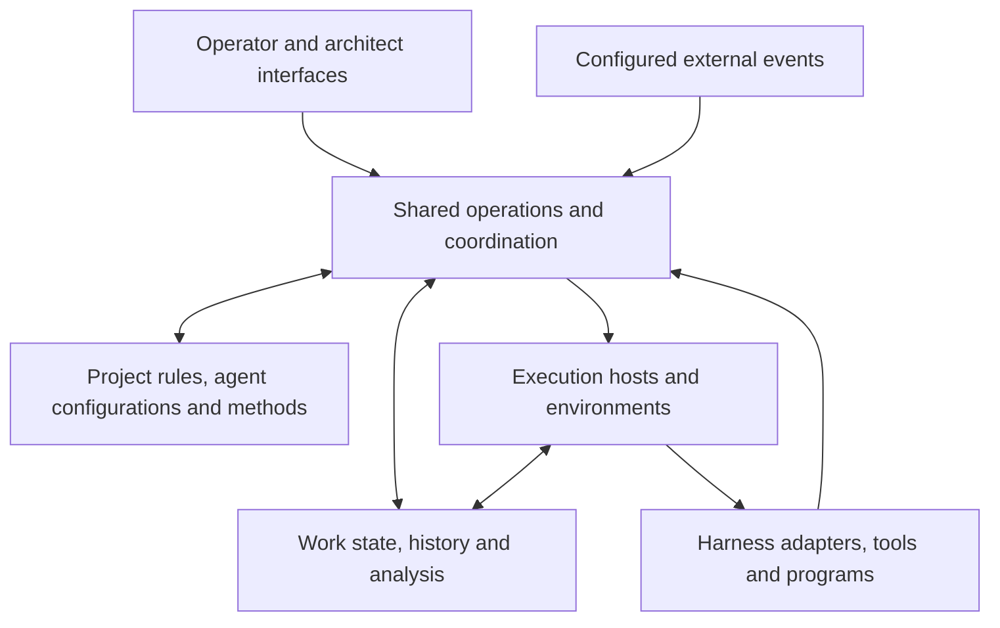

# Architecture map

Synthesis of accepted responsibilities. Blocks are logical boundaries, not separate services, processes or repositories. Implementation allocation remains open.

## Responsibility map

| Block | Responsibilities | Canonical detail |
|---|---|---|
| Human interfaces | Conversation, work overview, results, configuration, resource steering and experiments. | [Interfaces](interfaces.md) |
| Shared operations and coordination | Accepted assignments, delegation, dependencies, questions, continuation and eligible placement. | [Operations](system-operations.md), [orchestration](orchestration.md), [allocation](work-allocation.md) |
| Definitions | File-backed instructions, skills, agent configurations, project rules and callable methods. | [Project context](project-context.md), [methods](capabilities-and-pipelines.md) |
| State and evidence | Work identity and state, actual execution history, material references, observations and comparisons. | [Root contract](../fleet.md#work-management), [analysis](work-analysis.md) |
| Execution resources | Registered machines, environment readiness, working areas, local processes and resource observations. | [Deployment](deployment.md), [continuity](execution-continuity.md) |
| Execution integration | Native harness behavior and supported controls; tools and programs without synthetic sessions. | [Runtime boundary](runtime-integration.md), [execution contract](execution-contract.md) |

Laboratory work uses these same blocks with [experiment definitions and comparisons](lab.md). Balancing is a coordination responsibility. PM is a configured agent. SDD is an evaluable method. Connections supply service access across these blocks; they do not define a separate workflow engine.

## Initial physical placement

The accepted target places persistent coordination, the web interface and laboratory management on PDS-18. PDS-18, Mac and Windows may execute eligible work. Desktop and web clients use shared operations. Laboratory management on PDS-18 does not require every trial to run there.

## Next design package

The following proposes the next implementation-facing work; it does not select technology or authorize deployments.

| Boundary | Decision still needed | Required proof |
|---|---|---|
| Host registration and control | Enrollment, identity, transport and environment discovery. | Register a host, read its capabilities and availability, stop new assignment and restore eligibility. |
| Dispatch and recovery | Exact launch acknowledgment, command identity, result delivery and reconciliation contracts. | Disconnect during a launch; establish the original outcome without duplicate work. |
| Working materials | Preparation and transfer of repository state, assets and outputs across hosts. | Start with the correct inputs, open a remote result and preserve it through cleanup. |
| Native interaction | Supported messages, images, questions, controls and usage per harness and mode. | Complete a conversation and background assignment with an answered question. |
| Allocation and accounting | Initial placement rules, shared quota identity, capacity reservations and budget-limit behavior. | Steer queued work by host and harness; account for nested work and explain waits. |

## Proposed first vertical slice

Use one controlled assignment through persistent coordination and real execution hosts, with an observable result, a question and a disconnection. Change a host or harness routing rule for subsequent eligible work and verify the actual selection. Do not begin with a full interface suite or an autonomous optimizer.

This slice tests the shared path used by interactive work, project implementation and laboratory trials. Synthetic UI and source-level adapter coverage remain supporting evidence, not acceptance of that path. Product/repository reuse follows this contract and evidence, not existing product names.
